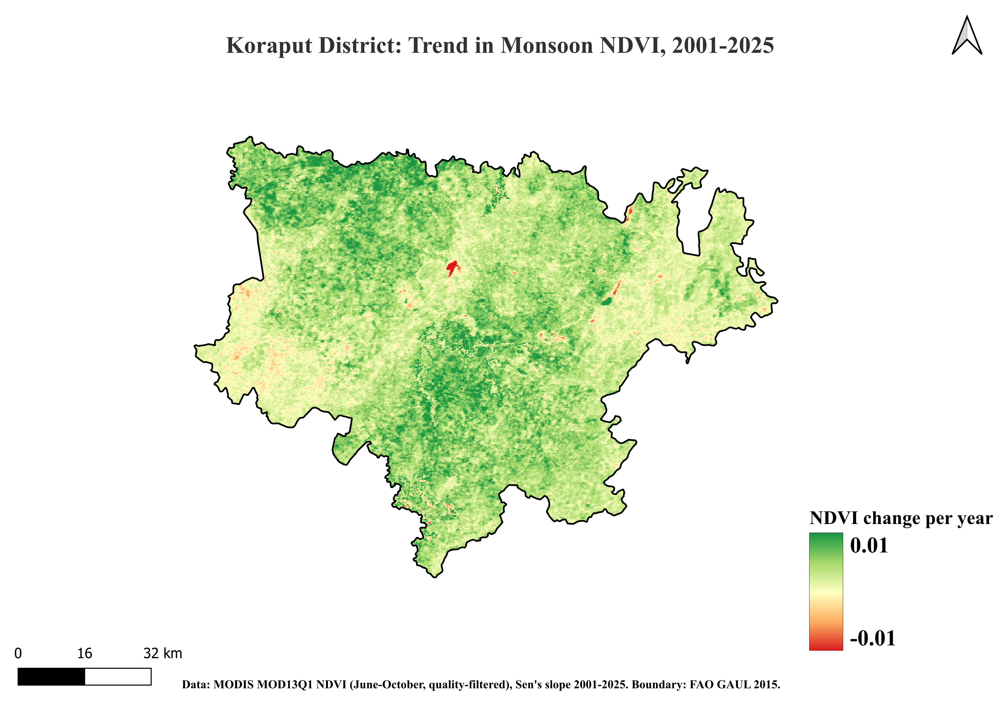
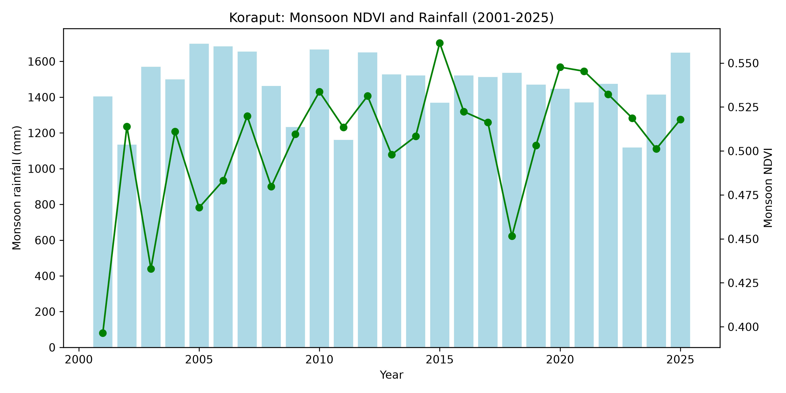
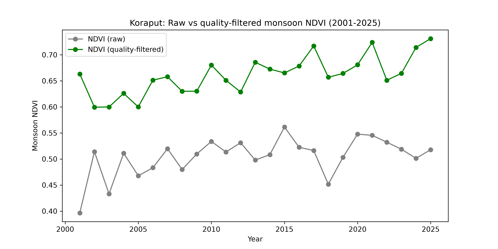

# Monsoon Vegetation and Rainfall Trends in Koraput, Odisha (2001-2025)

Trend analysis of monsoon-season vegetation greenness (NDVI) and rainfall in Koraput district, Odisha, India, using MODIS, CHIRPS and Google Earth Engine.



## Research question

Has monsoon-season vegetation greenness in Koraput district changed between 2001 and 2025, and is any change explained by changes in monsoon rainfall?

## Study area

Koraput district, Odisha, India. District boundary from FAO GAUL 2015 (level 2).

## Data

| Dataset | Use | Google Earth Engine ID |
|---|---|---|
| MODIS Terra Vegetation Indices 16-day, 250 m (MOD13Q1, v061) | NDVI, with the SummaryQA band for quality filtering | `MODIS/061/MOD13Q1` |
| CHIRPS Daily rainfall | Monsoon rainfall totals | `UCSB-CHG/CHIRPS/DAILY` |
| FAO GAUL 2015, level 2 | District boundary | `FAO/GAUL/2015/level2` |

## Method

1. For each year, 2001 to 2025, the monsoon season was defined as 1 June to 31 October.
2. Mean monsoon NDVI was computed over the district, both from the raw NDVI band and after removing poor-quality pixels (SummaryQA <= 1).
3. Total monsoon rainfall (mm) was summed from CHIRPS and averaged over the district.
4. Trends were tested with the Mann-Kendall test, and trend magnitude was estimated with Sen's slope (`pymannkendall`).
5. The relationship between NDVI and rainfall was tested with Pearson correlation.
6. A pixel-wise Sen's slope of quality-filtered NDVI was computed in Google Earth Engine and exported at 250 m. The final map layout was made in QGIS.

## Results

**District-level time series**



- **Quality-filtered NDVI shows a significant increasing trend** (Mann-Kendall p < 0.001; Sen's slope about 0.0037 NDVI per year, roughly 0.09 over the period). The trend remains significant when 2001 is excluded (slope about 0.0044 per year, p < 0.001).
- **Raw NDVI is much noisier.** The raw 2001 value (0.397) rises to 0.663 after quality filtering, which indicates cloud contamination in the raw data. The raw trend was significant only when 2001 was included (p = 0.038) and not significant without it (p = 0.107). This is why the quality-filtered series is used for the main result.



- **Monsoon rainfall shows no significant trend** (p = 0.252; Sen's slope about -4.7 mm per year).
- **NDVI and rainfall are not significantly correlated** at the yearly scale (quality-filtered NDVI: r = 0.08, p = 0.709; raw NDVI: r = -0.15, p = 0.485).

**Spatial pattern**

Greening is widespread across the district, with the strongest increases in the north-west and central parts. Only small, scattered areas show a decline. These localized declines were not investigated further.

## Interpretation

Monsoon vegetation in Koraput has become greener over 2001 to 2025, and this is not explained by changes in total monsoon rainfall. The cause was not tested in this project. Possible drivers that could be examined in future work include forest regrowth, plantations, land use or farming changes, and the timing of rainfall within the season.

## Limitations

- Results rely on a single sensor family (MODIS Terra); sensor drift or changes in the number of valid observations per year could affect trends.
- There was no field data. The results are not validated against ground observations.
- Yearly rainfall totals do not capture timing or intensity of rainfall.
- NDVI can saturate over dense vegetation, which may hide further greening.
- District-level values were extracted at 1 km scale; the trend map was exported at 250 m.
- The FAO GAUL 2015 dataset is marked as deprecated in Google Earth Engine; it was used here for the boundary only.

## Repository structure

```
.
├── README.md
├── ndvi_rainfall_trends_koraput.ipynb   # full analysis
├── koraput_ndvi_map.qgz                 # QGIS project for the final map
├── Data/                                # yearly CSV, trend raster, district boundary
└── Output/                              # figures and final map
```

## How to reproduce

1. Install Python and the libraries: `pip install jupyterlab earthengine-api geemap pandas matplotlib scipy pymannkendall`
2. Create a Google Cloud project, register it for Earth Engine, and replace the project ID in the notebook with your own.
3. Open `ndvi_rainfall_trends_koraput.ipynb` and run the cells in order.

## Author

Adarsh Kumar Sahu, M.Tech Remote Sensing and GIS, Birla Institute of Technology, Mesra.
